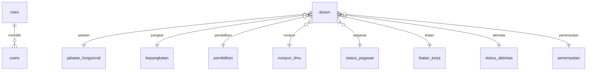

# SIMDOSEN - Sistem Informasi Dosen UM Bengkulu

Aplikasi web tradisional (PHP Native + PDO + MySQL + Bootstrap 5) dan Web Service REST API.
Database: `simdosen`.

## Fitur
- Landing page (`index.php`), login/logout, autentikasi dan RBAC (`includes/auth.php`)
- Dashboard statistik, CRUD Data Dosen, CRUD Master Data (8 tabel referensi), CRUD Pengguna
- Laporan daftar dosen dengan filter, cetak/PDF, dan export CSV
- REST API: `api/login.php`, `api/dosen.php`

## RBAC
| Hak akses | admin | operator | pimpinan |
|---|---|---|---|
| Dashboard, lihat data dosen, laporan | ya | ya | ya |
| Tambah/ubah dosen, kelola master data | ya | ya | - |
| Hapus dosen, kelola pengguna | ya | - | - |

Akun demo: `admin/admin123`, `operator/operator123`, `pimpinan/pimpinan123`.

## Skema Database


## Instalasi
1. Buat database MySQL, import `database.sql`.
2. Salin `config.local.example.php` menjadi `config.local.php`, isi kredensial.
3. Letakkan semua file di root web (`htdocs`), buka `index.php`.

`config.local.php` tidak diunggah ke GitHub (ada di `.gitignore`).

## Contoh API
```
POST api/login.php        {"username":"admin","password":"admin123"}  -> token
GET  api/dosen.php
POST api/dosen.php        Authorization: Bearer TOKEN
     {"nomor_registrasi":"REG-0010","nama":"Nama Dosen, M.Kom","status_serdos":"Belum","pendidikan_id":2,"penempatan_id":1}
PUT  api/dosen.php?id=1   Authorization: Bearer TOKEN   {"nama":"Nama Baru"}
DELETE api/dosen.php?id=1 Authorization: Bearer TOKEN
```
